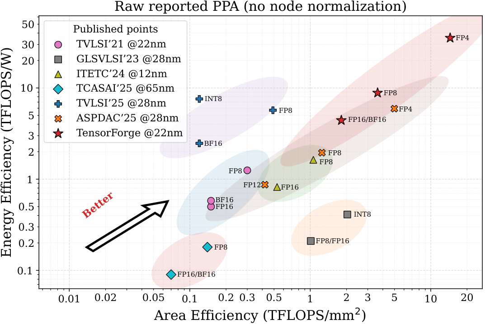
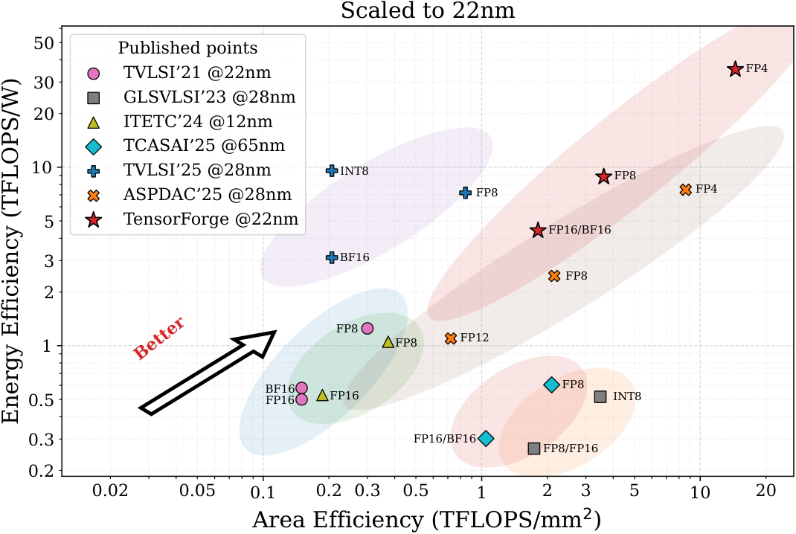

# TensorForge: Synthesis-Backed Design Space Exploration of Multi-Precision Tensor Core Microarchitectures


## Overview

Tensor cores drive most AI compute in GPGPUs, yet supporting multiple precisions under tight bandwidth, power, and area budgets remains a major microarchitecture challenge. **TensorForge** is a synthesis-backed framework for exploring multi-precision tensor core microarchitectures. TensorForge exposes compute-unit organization, precision configuration, and resource sharing as architectural knobs, generates synthesizable RTL for systematic comparison, and derives actionable design rules from over 600 configurations. The release also demonstrates practical deployability by integrating TensorForge-generated designs into an open-source GPGPU. Using the released clock-gated TensorForge comparison point at 22 nm, 0.9 V, and 1.41 GHz, TensorForge improves over the strongest prior point before node normalization by **2.90× area / 1.55× energy efficiency** for FP8, **1.79× / 1.79×** for FP16/BF16, and **2.90× / 5.96×** for FP4. After DeepScaleTool-based normalization to 22 nm, the gains remain **1.68× / 1.23×**, **1.04× / 1.42×**, and **1.69× / 4.73×**, respectively, while extending the area-power Pareto frontier.

## Highlights

- **Synthesis-backed exploration.** TensorForge turns architectural choices into synthesizable tensor-core RTL for controlled PPA comparison.
- **Multi-precision design knobs.** The framework exposes compute-unit organization, precision support, and resource-sharing policies as first-class parameters.
- **Large design sweep.** The released results cover **600+** synthesized configurations.
- **System-level deployability.** TensorForge-generated designs are demonstrated inside an open-source GPGPU stack.
- **Open release bundle.** The release includes RTL, a local area/power explorer website, synthesis-backed data, an open cost model, and extracted design rules.
- **Clock-gated update data.** The full 4,445-point clock-gated synthesis dataset is available as `tensorforge_site_bundle/data/clock_gated_area_power_measurements.csv` in the same CSV schema as the original measurements; `tensorforge_site_bundle/data/clock_gated_updates_2026/` contains FP4/LUT-FP4 summaries, clock-gated Pareto points, and retrained surrogate metrics.

## Main Result Snapshot

| Precision | Area Efficiency Gain | Energy Efficiency Gain |
| --- | ---: | ---: |
| FP8 | 2.90× raw / 1.68× normalized | 1.55× raw / 1.23× normalized |
| FP16/BF16 | 1.79× raw / 1.04× normalized | 1.79× raw / 1.42× normalized |
| FP4 | 2.90× raw / 1.69× normalized | 5.96× raw / 4.73× normalized |

These gains use the updated clock-gated 22 nm TensorForge point and a conservative best-prior-per-metric comparison. The normalized values use documented DeepScaleTool-derived node factors; same-flow TensorForge design rules remain based on synthesis data from the same flow.

## Comparison with Published Designs

<table>
  <thead>
    <tr>
      <th rowspan="2">Metric</th>
      <th colspan="2">TVLSI'21</th>
      <th colspan="2">GLSVLSI'23</th>
      <th colspan="2">ITETC'24</th>
      <th colspan="2">TCASAI'25</th>
      <th colspan="2">TVLSI'25</th>
      <th colspan="2">ASPDAC'25</th>
      <th colspan="2"><strong>TensorForge</strong></th>
    </tr>
    <tr>
      <th>Format</th><th>Value</th>
      <th>Format</th><th>Value</th>
      <th>Format</th><th>Value</th>
      <th>Format</th><th>Value</th>
      <th>Format</th><th>Value</th>
      <th>Format</th><th>Value</th>
      <th>Format</th><th>Value</th>
    </tr>
  </thead>
  <tbody>
    <tr>
      <td>Technology</td>
      <td colspan="2">22nm</td>
      <td colspan="2">28nm</td>
      <td colspan="2">12nm</td>
      <td colspan="2">65nm</td>
      <td colspan="2">28nm</td>
      <td colspan="2">28nm</td>
      <td colspan="2"><strong>22nm</strong></td>
    </tr>
    <tr>
      <td>Freq. (GHz)</td>
      <td colspan="2">0.92</td>
      <td colspan="2">2.5</td>
      <td colspan="2">1.26</td>
      <td colspan="2">0.741</td>
      <td colspan="2">0.4</td>
      <td colspan="2">1.43</td>
      <td colspan="2"><strong>1.41</strong></td>
    </tr>
    <tr>
      <td rowspan="3">TFLOPS/W</td>
      <td>FP8</td><td>1.25</td>
      <td>FP8</td><td>0.21</td>
      <td>FP8</td><td>1.63</td>
      <td>FP8</td><td>0.18</td>
      <td>FP8</td><td>5.70</td>
      <td>FP8</td><td>1.95</td>
      <td><strong>FP8</strong></td><td><strong>8.84</strong></td>
    </tr>
    <tr>
      <td>FP16</td><td>0.50</td>
      <td>FP16</td><td>0.21</td>
      <td>FP16</td><td>0.82</td>
      <td>FP16</td><td>0.09</td>
      <td>BF16</td><td>2.47</td>
      <td>FP12</td><td>0.87</td>
      <td><strong>FP16/BF16</strong></td><td><strong>4.42</strong></td>
    </tr>
    <tr>
      <td>BF16</td><td>0.58</td>
      <td>INT8</td><td>0.41</td>
      <td>-</td><td>-</td>
      <td>BF16</td><td>0.09</td>
      <td>INT8</td><td>7.58</td>
      <td>FP4</td><td>5.93</td>
      <td><strong>FP4</strong></td><td><strong>35.35</strong></td>
    </tr>
    <tr>
      <td rowspan="3">TFLOPS/mm²</td>
      <td>FP8</td><td>0.30</td>
      <td>FP8</td><td>1.01</td>
      <td>FP8</td><td>1.06</td>
      <td>FP8</td><td>0.14</td>
      <td>FP8</td><td>0.49</td>
      <td>FP8</td><td>1.25</td>
      <td><strong>FP8</strong></td><td><strong>3.62</strong></td>
    </tr>
    <tr>
      <td>FP16</td><td>0.15</td>
      <td>FP16</td><td>1.01</td>
      <td>FP16</td><td>0.53</td>
      <td>FP16</td><td>0.07</td>
      <td>BF16</td><td>0.12</td>
      <td>FP12</td><td>0.42</td>
      <td><strong>FP16/BF16</strong></td><td><strong>1.81</strong></td>
    </tr>
    <tr>
      <td>BF16</td><td>0.15</td>
      <td>INT8</td><td>2.03</td>
      <td>-</td><td>-</td>
      <td>BF16</td><td>0.07</td>
      <td>INT8</td><td>0.12</td>
      <td>FP4</td><td>4.99</td>
      <td><strong>FP4</strong></td><td><strong>14.48</strong></td>
    </tr>
  </tbody>
</table>

## Pareto Comparison Figure

Raw reported area/energy comparison:



DeepScaleTool-normalized 22 nm area/energy comparison:




## Repository Contents

This repository is organized as an open research artifact and public RTL/data release. It provides the following components:

- **Synthesizable tensor-core RTL** for systematic microarchitectural comparison.
- **A static website** with browser-side queries for measured and estimate-backed area/power results.
- **Synthesis datasets** used to analyze multi-precision design trade-offs.
- **An open cost model** used by the explorer to render predictions when direct measurements are unavailable.
- **Open design rules** distilled from synthesis-backed exploration across the released design space.

## Quick Start

Build and preview the static explorer with Python's standard library:

```bash
cd tensorforge_site_bundle
python3 -m tools.area_power_explorer.main serve --host 127.0.0.1 --port 8000
```

Then open:

```text
http://127.0.0.1:8000/
```

The readable website source is in `tensorforge_site_bundle/web/area_power_explorer/`.
The build output is in `tensorforge_site_bundle/artifacts/area_power_explorer/site/`
and is ignored by Git. Deploy the contents of that generated directory to a static
host. Relative URLs support the GitHub Pages project path `/TensorForge/`.
Queries, array scaling, and chart calculations run in the browser; the host only
serves files. No Python API, SQLite server, model runtime, or WebAssembly is needed
for the deployed site.

The interface supports English and Simplified Chinese, remembers the selected
language, and otherwise follows the browser language. Information buttons explain
architectural controls and result provenance on hover, focus, or tap. Colors,
including chart labels and controls, follow the system's light/dark preference.
Charts adapt to the available width while preserving readable text; on phones,
the area-breakdown legend appears below the ring. Tap chart marks or legend
entries to inspect their values.

After updating measurements or the offline prediction artifacts, regenerate the
static site from the bundle root:

```bash
python3 -m tools.area_power_explorer.main export-static
# Or export a standalone deployment directory:
python3 -m tools.area_power_explorer.main export-static --out-dir /tmp/tensorforge-site
```

Export rebuilds measurements from the source CSVs and reuses the released
prediction CSV; it does not train models or require `data/.venv`. Model training
remains an offline Python build step.

### GitHub Pages

[The website workflow](.github/workflows/pages.yml) checks data consistency,
browser/Python query parity, and real-browser language/theme interactions, then
exports a clean `_site/` artifact. Pull requests run the checks; pushes to `main`
and manual runs on `main` also publish through the `github-pages` environment.
Only the generated website is uploaded.

A repository maintainer must enable **Settings → Pages → Source: GitHub Actions**.
After the workflow is pushed and successfully deployed, the project website is
available at `https://liuweibupt.github.io/TensorForge/`.

### Website maintenance

- Edit pages/styles and `ui.mjs` in the source directory. Keep both language
  dictionaries complete; technical configuration values remain unchanged.
- The source `explorer.mjs` has a data placeholder. `export-static` embeds all
  website datasets into the output program; generated data is not checked into
  the website source.
- Update the training subset and offline model artifacts alongside changed
  measurements. The checks reject training records or prediction targets that
  do not match the released clock-gated measurements.
- Run `python3 -m unittest discover -s tests/area_power_explorer -v` from the
  repository root. After export, run
  `node tests/area_power_explorer/browser_smoke.mjs` with Node 24 and Chrome for
  interface checks. These website checks require no Python model dependencies.
- `serve` previews the static build. The optional Python API is available with
  `serve-api`; `build` remains the offline database/model build command.

## How to Inspect the Website Results

### 1. Query a design point

Open the **Query** page and choose the architectural fields exposed by the interface:

- `M`, `N`, `K`
- `Clock (MHz)`
- `Precision`
- `MX`, `NV`
- `Norm`, `Acc`, `Out`
- `midMat`
- `Prediction Fallback`

Click **Run Query** to retrieve the matching result.

### 2. Read the returned result type

The website distinguishes among three result sources:

- **Synthesized Array** (`measured_array`): directly synthesized array-level data; displayed unit costs are per-unit averages of the array totals.
- **Derived from Synthesized Unit** (`derived_measured_unit`): array-level estimates scaled from synthesized dot-product units.
- **Offline Model Prediction** (`predicted_unit`): estimates from the released cost-model prediction table.

The browser checks measured arrays first, then scales a matching measured unit by
`M × N`, and finally looks up an offline prediction when fallback is enabled.
Missing configurations return a structured no-data result. The prediction table
contains released configurations; arbitrary new configurations are not evaluated
by a model at query time. Measurements, predictions, baseline comparisons, and
area breakdowns are compiled into `explorer.mjs`, loaded once with the program.
The site makes no separate JSON data downloads or query API requests.

The result panel shows the explicit area and power formulas. The query engine
also computes operations per cycle and theoretical throughput.

### 3. Inspect the other data views

Use the navigation bar at the top of the site to open:

- **PPA Explorer** for area-versus-power scatter plots across measured units and measured arrays.
- **Baseline Compare** for side-by-side comparison between prior designs and TensorForge-generated points.
- **Breakdown** for component-level area decomposition views.
- **Precision Reuse Lab** for hands-on area DSE across the paper’s 18 sharing templates: select required formats, K and clock target; compare unified, hybrid and dedicated datapaths; set an area budget; inspect exact constituent sources; share an experiment link or export CSV.

Together, these pages provide both query-oriented inspection and global visual analysis of the released synthesis results.

Open the lab at `http://127.0.0.1:8000/reuse.html`. It uses the current clock-gated unit measurements in `clock_gated_area_power_measurements.csv`, with 18 templates × 5 base K values × 7 clock targets = 630 derived design points. Area is a sum of exact constituent units, excluding additional integration overhead. Deselecting a format removes only whole datapaths that support none of the remaining required formats; retained shared units keep their full measured area. The reference is dedicated arithmetic strategy S14 at the same operating point and format requirements. The browser computes all compositions and requirement filtering from exact static unit measurements; no runtime API is used. The synthesis target does not certify timing closure.

## Open Cost Model

TensorForge releases the cost models used to support estimate-backed exploration on the website.

### Released models

The current packaged model artifacts contain two trained predictors:

1. `dp_model_by_clk`
   - Script: `dp_model.py`
   - Type: single-stage linear model for `area_value` and `total_value`
   - Best configuration: `log_target=true`
   - Grouping key: `clk_mhz`
   - Cross-validation: 5-fold
2. `dp_two_stage_reuse_by_clk`
   - Script: `dp_two_stage_model.py`
   - Type: two-stage reuse model
     - Stage-A estimates single-mode area and power
     - Stage-B estimates reuse ratio
   - Grouping key: `clk_mhz`
   - Scope: `reuse`
   - Cross-validation: 7-fold

### Dataset scale

According to `prediction_manifest.json`, the released training set contains 560 samples:

- `DotProductWrapper`: 420
- `DotProductINT8INT4Wrapper`: 70
- `DotProductINT8INT4ReuseWrapper`: 35
- `DotProductFP4Wrapper`: 35

### Feature set

`dp_features.csv` contains 29 columns. The core model inputs include:

- Structure/configuration features:
  - `clk_mhz`
  - `precision_set`
  - `dimK`
  - `mx`
  - `out_kind`
  - `midMat`
- Targets:
  - `area_value`
  - `total_value`
- Engineered features:
  - `lut_fp4`
  - `fp_format_count`
  - `int_format_count`
  - `total_format_count`
  - `fp_mantissa_bits_total`
  - `fp_exponent_groups`
  - `fp_mantissa_groups`
  - `int_bits_total`
  - `has_fp_acc`
  - `has_int_acc`
  - `has_norm_align`
  - `has_adder_tree`
  - `has_mx_scale`
  - `log2_dimK`
  - `fp_mantissa_bits_x_dimK`
  - `int_bits_x_dimK`
  - `fp_format_count_x_dimK`
  - `int_format_count_x_dimK`

### Interpretable signals captured by the models

From `dp_model_formula_by_clk.txt`, the single-stage model is most influenced by:

- Area (`area_value`):
  - `has_int_acc`
  - `midMat_26`
  - `midMat_9`
  - `lut_fp4`
  - `log2_dimK`
  - `out_kind_INT32`
  - `has_norm_align`
  - `has_fp_acc`
- Power (`total_value`):
  - `lut_fp4`
  - `out_kind_INT32`
  - `has_norm_align`
  - `has_fp_acc`
  - `int_format_count`
  - `midMat_26`
  - `log2_dimK`
  - `total_format_count`

From `dp_two_stage_formula_reuse_by_clk.txt`, the two-stage reuse model is dominated by:

- Stage-A:
  - `log2_dimK`
  - `mode_INT4`
  - `mode_MXFP4LUT`
  - `midMat_9`
  - `mx_noMXnoNV`
  - `norm_kind_FP32`
  - `acc_kind_INT32`
  - `out_kind_INT32`
  - `clk_mhz`
- Stage-B:
  - `log2_dimK`
  - `P_ded_std`
  - `share_mul`
  - `share_exp`
  - `share_norm_align`
  - `share_fp_acc`
  - `P_ded_hat`
  - `A_ded_hat`
  - `A_dom_frac`
  - `P_dom_frac`
  - `n_modes_unique`
  - `mux_inputs`

### Predictive performance

The current TensorForge website bundle contains two model families with the following best reported results:

| Model | Target | Validation | Mean R² | Mean MAPE |
| --- | --- | --- | ---: | ---: |
| `dp_model_by_clk` | Area | 5-fold grouped by `clk_mhz`, clock-gated training data | 0.9505 | 8.03% |
| `dp_model_by_clk` | Power (`total_value`) | 5-fold grouped by `clk_mhz`, clock-gated training data | 0.9562 | 8.57% |
| `dp_two_stage_reuse_by_clk` | Area | 7-fold grouped CV, `scope=reuse` | 0.9970 | 2.95% |
| `dp_two_stage_reuse_by_clk` | Power | 7-fold grouped CV, `scope=reuse` | 0.9979 | 2.50% |

Additional notes:

- The current model artifacts use 560 clock-gated synthesized dot-product samples.
- The two-stage `scope=reuse` metrics evaluate reuse rows while single-mode rows
  remain available to train Stage-A. These numbers describe that validation scope,
  rather than all-configuration prediction accuracy. The historical 2026-06-21
  all-row metrics remain in `data/clock_gated_updates_2026/` for the earlier report.
- The surrogate is used for explanation and future pruning only; all reported PPA points, Pareto fronts, and design rules remain synthesis-backed.
- The single-stage model `dp_model_by_clk` is retained as the baseline model family and has also been synchronized with the clock-gated training data.

### Role in the website

When a queried design point does not have a directly released measurement, the explorer can use the released cost models to render **estimate-backed results** instead of returning an empty view. This enables fast what-if inspection while making the modeling assumptions, feature set, and expected accuracy explicit.

## Open Design Rules

Beyond raw RTL and synthesis outputs, TensorForge releases **actionable design rules** extracted from the full synthesis campaign. These rules summarize how compute-unit organization, precision composition, and resource-sharing choices shape area and power efficiency across the explored design space.

In other words, the repository is intended not only to reproduce numbers, but also to help researchers and hardware designers reuse the lessons behind those numbers.

