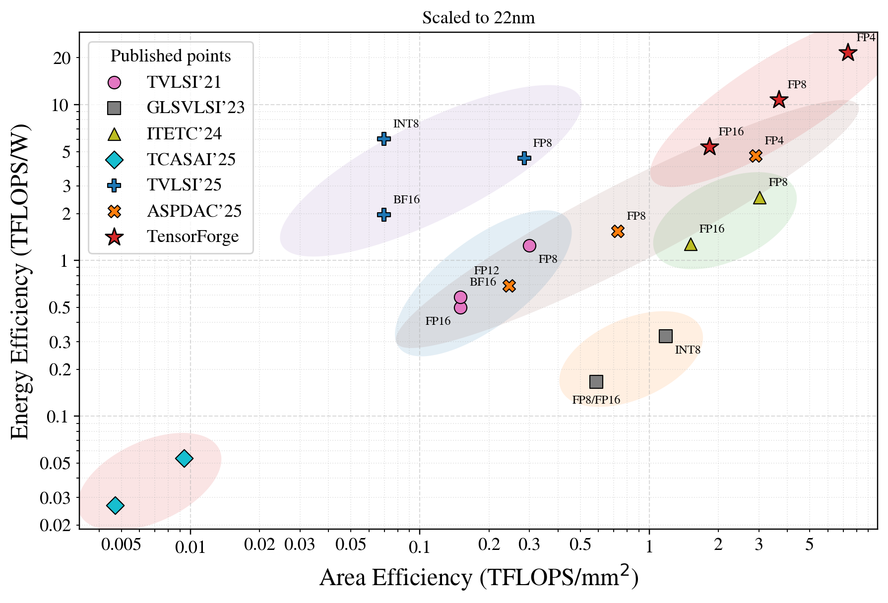

# TensorForge: Synthesis-Backed Design Space Exploration of Multi-Precision Tensor Core Microarchitectures


## Abstract

Tensor cores drive most AI compute in GPGPUs, yet supporting multiple precisions under tight bandwidth, power, and area budgets remains a major microarchitecture challenge. We present **TensorForge**, a synthesis-backed framework for exploring multi-precision tensor core microarchitectures. TensorForge exposes compute-unit organization, precision configuration, and resource sharing as architectural knobs, generates synthesizable RTL for systematic comparison, and derives actionable design rules from over 600 configurations. We further demonstrate practical deployability by integrating TensorForge-generated designs into an open-source GPGPU. Under the updated rebuttal comparison, the clock-gated TensorForge point is evaluated at 22 nm, 0.9 V, and 1.41 GHz. Before node normalization, it improves over the strongest prior point by **2.90× area / 1.55× energy efficiency** for FP8, **1.79× / 1.79×** for FP16/BF16, and **2.90× / 5.96×** for FP4. After DeepScaleTool-based normalization to 22 nm, the gains remain **1.68× / 1.23×**, **1.04× / 1.42×**, and **1.69× / 4.73×**, respectively, while extending the area-power Pareto frontier.

## Highlights

- **Synthesis-backed exploration.** TensorForge turns architectural choices into synthesizable tensor-core RTL for controlled PPA comparison.
- **Multi-precision design knobs.** The framework exposes compute-unit organization, precision support, and resource-sharing policies as first-class parameters.
- **Large design sweep.** The released results cover **600+** synthesized configurations.
- **System-level deployability.** TensorForge-generated designs are demonstrated inside an open-source GPGPU stack.
- **Open artifact bundle.** The release includes RTL, a local area/power explorer website, synthesis-backed data, an open cost model, and extracted design rules.
- **Rebuttal update data.** The full 4,445-point clock-gated synthesis dataset is also available as `tensorforge_site_bundle/data/clock_gated_area_power_measurements.csv` in the same CSV schema as the original measurements; `tensorforge_site_bundle/data/rebuttal_2026/` additionally contains FP4/LUT-FP4 summaries, clock-gated Pareto points, and retrained surrogate metrics used in the rebuttal.

## Main Result Snapshot

| Precision | Area Efficiency Gain | Energy Efficiency Gain |
| --- | ---: | ---: |
| FP8 | 2.90× raw / 1.68× normalized | 1.55× raw / 1.23× normalized |
| FP16/BF16 | 1.79× raw / 1.04× normalized | 1.79× raw / 1.42× normalized |
| FP4 | 2.90× raw / 1.69× normalized | 5.96× raw / 4.73× normalized |

These gains use the updated clock-gated 22 nm TensorForge point and a conservative best-prior-per-metric comparison. The normalized values use documented DeepScaleTool-derived node factors; same-flow TensorForge design rules remain based on synthesis data from the same flow.

## Comparison with Previous Works

<table>
  <thead>
    <tr>
      <th rowspan="2">Metric</th>
      <th colspan="2">TVLSI'21</th>
      <th colspan="2">GLSVLSI'23</th>
      <th colspan="2">ITETC'24</th>
      <th colspan="2">TCASAI'25</th>
      <th colspan="2">TVLSI'25</th>
      <th colspan="2">ASPDAC'25</th>
      <th colspan="2"><strong>Ours</strong></th>
    </tr>
    <tr>
      <th>Format</th><th>Value</th>
      <th>Format</th><th>Value</th>
      <th>Format</th><th>Value</th>
      <th>Format</th><th>Value</th>
      <th>Format</th><th>Value</th>
      <th>Format</th><th>Value</th>
      <th>Format</th><th>Value</th>
    </tr>
  </thead>
  <tbody>
    <tr>
      <td>Technology</td>
      <td colspan="2">22nm</td>
      <td colspan="2">28nm</td>
      <td colspan="2">12nm</td>
      <td colspan="2">65nm</td>
      <td colspan="2">28nm</td>
      <td colspan="2">28nm</td>
      <td colspan="2"><strong>22nm</strong></td>
    </tr>
    <tr>
      <td>Freq. (GHz)</td>
      <td colspan="2">0.92</td>
      <td colspan="2">2.5</td>
      <td colspan="2">1.26</td>
      <td colspan="2">0.741</td>
      <td colspan="2">0.4</td>
      <td colspan="2">1.43</td>
      <td colspan="2"><strong>1.41</strong></td>
    </tr>
    <tr>
      <td rowspan="3">TFLOPS/W</td>
      <td>FP8</td><td>1.25</td>
      <td>FP8</td><td>0.21</td>
      <td>FP8</td><td>1.63</td>
      <td>FP8</td><td>0.18</td>
      <td>FP8</td><td>5.70</td>
      <td>FP8</td><td>1.95</td>
      <td><strong>FP8</strong></td><td><strong>8.84</strong></td>
    </tr>
    <tr>
      <td>FP16</td><td>0.50</td>
      <td>FP16</td><td>0.21</td>
      <td>FP16</td><td>0.82</td>
      <td>FP16</td><td>0.09</td>
      <td>BF16</td><td>2.47</td>
      <td>FP12</td><td>0.87</td>
      <td><strong>FP16/BF16</strong></td><td><strong>4.42</strong></td>
    </tr>
    <tr>
      <td>BF16</td><td>0.58</td>
      <td>INT8</td><td>0.41</td>
      <td>-</td><td>-</td>
      <td>BF16</td><td>0.09</td>
      <td>INT8</td><td>7.58</td>
      <td>FP4</td><td>5.93</td>
      <td><strong>FP4</strong></td><td><strong>35.35</strong></td>
    </tr>
    <tr>
      <td rowspan="3">TFLOPS/mm²</td>
      <td>FP8</td><td>0.30</td>
      <td>FP8</td><td>1.01</td>
      <td>FP8</td><td>1.06</td>
      <td>FP8</td><td>0.14</td>
      <td>FP8</td><td>0.49</td>
      <td>FP8</td><td>1.25</td>
      <td><strong>FP8</strong></td><td><strong>3.62</strong></td>
    </tr>
    <tr>
      <td>FP16</td><td>0.15</td>
      <td>FP16</td><td>1.01</td>
      <td>FP16</td><td>0.53</td>
      <td>FP16</td><td>0.07</td>
      <td>BF16</td><td>0.12</td>
      <td>FP12</td><td>0.42</td>
      <td><strong>FP16/BF16</strong></td><td><strong>1.81</strong></td>
    </tr>
    <tr>
      <td>BF16</td><td>0.15</td>
      <td>INT8</td><td>2.03</td>
      <td>-</td><td>-</td>
      <td>BF16</td><td>0.07</td>
      <td>INT8</td><td>0.12</td>
      <td>FP4</td><td>4.99</td>
      <td><strong>FP4</strong></td><td><strong>14.48</strong></td>
    </tr>
  </tbody>
</table>

## Pareto Comparison Figure




## Released Artifact

This repository is organized as a paper artifact rather than a software-only code drop. It releases the following components:

- **Synthesizable tensor-core RTL** for systematic microarchitectural comparison.
- **A local website** for querying measured and estimate-backed area/power results.
- **Synthesis datasets** used to analyze multi-precision design trade-offs.
- **An open cost model** used by the explorer to render predictions when direct measurements are unavailable.
- **Open design rules** distilled from synthesis-backed exploration across the released design space.

## Quick Start

Launch the local explorer website as follows:

```bash
cd tensorforge_site_bundle
python3 -m tools.area_power_explorer.main build
python3 -m tools.area_power_explorer.main serve --host 127.0.0.1 --port 8000
```

Then open:

```text
http://127.0.0.1:8000/
```

## How to Inspect the Website Results

### 1. Query a design point

Open the **Query** page and choose the architectural fields exposed by the interface:

- `M`, `N`, `K`
- `Clock (MHz)`
- `Precision`
- `MX`, `NV`
- `Norm`, `Acc`, `Out`
- `midMat`
- `Prediction Fallback`

Click **Run Query** to retrieve the matching result.

### 2. Read the returned result type

The website distinguishes among three result sources:

- **Measured Array**: directly synthesized array-level data.
- **Derived from Measured Unit**: array-level results derived from measured dot-product units.
- **Predicted Unit**: estimate-backed results produced by the open cost model.

The result panel also shows the explicit formulas used to compute area, power, and operations per cycle, which makes each returned value auditable rather than opaque.

### 3. Inspect the other data views

Use the navigation bar at the top of the site to open:

- **PPA Explorer** for area-versus-power scatter plots across measured units and measured arrays.
- **Baseline Compare** for side-by-side comparison between prior designs and TensorForge-generated points.
- **Breakdown** for component-level area decomposition views.

Together, these pages provide both query-oriented inspection and global visual analysis of the released synthesis results.

## Open Cost Model

TensorForge releases the cost models used to support estimate-backed exploration on the website.

### Released models

The current packaged model artifacts contain two trained predictors:

1. `dp_model_by_clk`
   - Script: `dp_model.py`
   - Type: single-stage linear model for `area_value` and `total_value`
   - Best configuration: `log_target=true`
   - Grouping key: `clk_mhz`
   - Cross-validation: 5-fold
2. `dp_two_stage_reuse_by_clk`
   - Script: `dp_two_stage_model.py`
   - Type: two-stage reuse model
     - Stage-A estimates single-mode area and power
     - Stage-B estimates reuse ratio
   - Grouping key: `clk_mhz`
   - Scope: `reuse`
   - Cross-validation: 7-fold

### Dataset scale

According to `prediction_manifest.json`, the released training set contains 560 samples:

- `DotProductWrapper`: 420
- `DotProductINT8INT4Wrapper`: 70
- `DotProductINT8INT4ReuseWrapper`: 35
- `DotProductFP4Wrapper`: 35

### Feature set

`dp_features.csv` contains 29 columns. The core model inputs include:

- Structure/configuration features:
  - `clk_mhz`
  - `precision_set`
  - `dimK`
  - `mx`
  - `out_kind`
  - `midMat`
- Targets:
  - `area_value`
  - `total_value`
- Engineered features:
  - `lut_fp4`
  - `fp_format_count`
  - `int_format_count`
  - `total_format_count`
  - `fp_mantissa_bits_total`
  - `fp_exponent_groups`
  - `fp_mantissa_groups`
  - `int_bits_total`
  - `has_fp_acc`
  - `has_int_acc`
  - `has_norm_align`
  - `has_adder_tree`
  - `has_mx_scale`
  - `log2_dimK`
  - `fp_mantissa_bits_x_dimK`
  - `int_bits_x_dimK`
  - `fp_format_count_x_dimK`
  - `int_format_count_x_dimK`

### Interpretable signals captured by the models

From `dp_model_formula_by_clk.txt`, the single-stage model is most influenced by:

- Area (`area_value`):
  - `has_int_acc`
  - `midMat_26`
  - `midMat_9`
  - `lut_fp4`
  - `log2_dimK`
  - `out_kind_INT32`
  - `has_norm_align`
  - `has_fp_acc`
- Power (`total_value`):
  - `lut_fp4`
  - `out_kind_INT32`
  - `has_norm_align`
  - `has_fp_acc`
  - `int_format_count`
  - `midMat_26`
  - `log2_dimK`
  - `total_format_count`

From `dp_two_stage_formula_reuse_by_clk.txt`, the two-stage reuse model is dominated by:

- Stage-A:
  - `log2_dimK`
  - `mode_INT4`
  - `mode_MXFP4LUT`
  - `midMat_9`
  - `mx_noMXnoNV`
  - `norm_kind_FP32`
  - `acc_kind_INT32`
  - `out_kind_INT32`
  - `clk_mhz`
- Stage-B:
  - `log2_dimK`
  - `P_ded_std`
  - `share_mul`
  - `share_exp`
  - `share_norm_align`
  - `share_fp_acc`
  - `P_ded_hat`
  - `A_ded_hat`
  - `A_dom_frac`
  - `P_dom_frac`
  - `n_modes_unique`
  - `mux_inputs`

### Predictive performance

The current TensorForge website bundle contains two model families with the following best reported results:

| Model | Target | Validation | Mean R² | Mean MAPE |
| --- | --- | --- | ---: | ---: |
| `dp_model_by_clk` | Area | 5-fold grouped by `clk_mhz` | 0.9536 | 7.89% |
| `dp_model_by_clk` | Power (`total_value`) | 5-fold grouped by `clk_mhz` | 0.9620 | 7.59% |
| `dp_two_stage_reuse_by_clk` | Area | 7-fold grouped CV, retrained 2026-06-21 | 0.9859 | 8.08% |
| `dp_two_stage_reuse_by_clk` | Power | 7-fold grouped CV, retrained 2026-06-21 | 0.9726 | 7.34% |

Additional notes:

- The retrained two-stage model uses 560 synthesized dot-product samples and reports the stricter 7-fold cross-validation used in the rebuttal artifact.
- The surrogate is used for explanation and future pruning only; all reported PPA points, Pareto fronts, and design rules remain synthesis-backed.
- The single-stage model `dp_model_by_clk` is retained as an older baseline model for the website bundle.

### Role in the website

When a queried design point does not have a directly released measurement, the explorer can use the released cost models to render **estimate-backed results** instead of returning an empty view. This enables fast what-if inspection while making the modeling assumptions, feature set, and expected accuracy explicit.

## Open Design Rules

Beyond raw RTL and synthesis outputs, TensorForge releases **actionable design rules** extracted from the full synthesis campaign. These rules summarize how compute-unit organization, precision composition, and resource-sharing choices shape area and power efficiency across the explored design space.

In other words, the repository is intended not only to reproduce numbers, but also to help researchers and hardware designers reuse the lessons behind those numbers.


